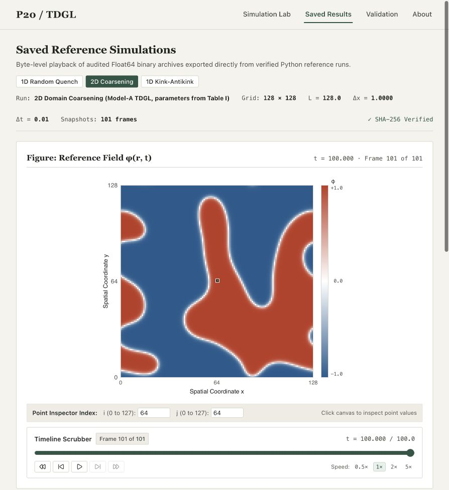

# P20: Simulating the 1D and 2D TDGL equation

Executed finite-difference simulations of the real scalar, nonconserved Model-A equation:

$$\partial_t\phi=\phi-\phi^3+\nabla^2\phi.$$

Antigravity produced the numerical implementation. Codex independently audited the equations, discretization, saved fields, diagnostics and deliverables, and corrected issues found during review. The allocation image and two professor-provided papers are the project sources. There is no external dataset.

[Live laboratory](https://idc-p20.vercel.app) · [GitHub source](https://github.com/ChandranilDas/IDC_P20) · [CV summary](docs/PORTFOLIO.md)



## Start here

- [14-page detailed technical report](docs/P20_Technical_Report.pdf)
- [Editable report text](docs/P20_Technical_Report.md)
- [Five-slide final presentation](presentation/P20_Progress_Presentation.pptx)
- [1D animation](results/animations/tdgl_1d_evolution.gif)
- [2D animation](results/animations/tdgl_2d_coarsening.gif)
- [Source audit](docs/source_notes.md)
- [Execution record](audit/EXECUTION_RECORD.md)
- [Independent full replay](audit/independent_full_replay.json)

## Synchronized release

The report, final deck, executed notebook and app Saved Results use the same archived numerical fields. `results/reference_results.json` records their exact summaries and source hashes. `python scripts/sync_release.py --check` verifies current artifact copies. The web downloads match these current files.

The app live reference presets use the archived seed-42 initial fields at the matching full reference geometries. Their default endpoints are shorter (t=40 / t=25) than the full archived runs (t=1000 / t=100). Other live configurations use the labelled browser generator. Compare runs at equal initial fields, grid, time step and time.

- [Executed simulation notebook](notebooks/P20_Simulations.ipynb)
- [Exact reference summaries](results/reference_results.json)

## Executed experiments

| Experiment | Box / grid | Time step | End time | Observation |
| --- | --- | --- | --- | --- |
| 1D random quench | L=100, N=1024 | 0.001 | 1000 | Six periodic domain walls remain |
| 2D random quench | L=128, 128×128 | 0.01 | 100 | Larger domains remain after coarsening |
| 1D kink–antikink | L=100, N=1024, R0=7 | 0.001 | 800 | Pair annihilates into phi≈−1 |
| Kink residual | L=60, N=128…2048 | Static interior test | — | RMS residual order 1.98947 |

Random quenches use `numpy.random.default_rng(42)` and uniform fluctuations in [-0.05,0.05]. Zero mean denotes the noise ensemble; individual sampled means are not forced to zero. The main grid/time-step settings match Yadav et al. (2024), Table I. The pair separation was shortened from the 2023 paper's R0=10 to demonstrate annihilation in a practical run.

The spatial Laplacian uses central nearest-neighbour stencils and periodic indexing. Forward Euler advances time. The discrete GL free energy uses squared forward edge differences, so its gradient matches the implemented Laplacian.

## Reproduce

Use Python 3.10 or newer. From this folder:

```sh
python -m venv .venv
source .venv/bin/activate
python -m pip install -r requirements.txt
python -m pytest -q
python experiments/run_all.py
```

The full scientific pipeline was rerun successfully on 14 November 2026 in 37.56 seconds on this machine. Runtime varies with hardware and installed versions. `audit/environment_freeze.txt` records the environment used.

The main pipeline runs both random quenches, the pair experiment, the interior kink residual comparison and validation, and regenerates plots and animations. Results are in `results/raw/`, `results/figures/`, `results/animations/` and `results/validation/`. The two GIFs each contain 101 frames; frame distinctness is checked in `audit/animation_checks.json`.

For independent checks:

```sh
python audit/check_implementation.py audit/implementation_checks.json
python audit/temporal_convergence.py
python audit/replay_runs.py
python audit/save_spectra.py
```

The replay implements the update and energy formulas independently, compares every saved snapshot, and checks free energy at every integration step. The implementation check also tests rectangular grids with unequal spacing.

## Validation evidence

- 13 project tests pass: fixed points, seed reproducibility, periodic operators, energy consistency, spatial/temporal convergence, stability and spectral accounting.
- Independent replay: 1,810,000 steps; no energy increases above 1e-9; maximum discrepancy from saved fields below 2.5e-12.
- Kink interior residual orders: 1.98947 (RMS) and 1.96640 (maximum norm).
- Exact homogeneous nonlinear-solution check: measured temporal order 0.99860 in both dimensions.
- Independent periodic Fourier eigenmode errors below 4e-14.
- Linear step/bound ratios: 0.2107152 in 1D and 0.05 in 2D. An intentional 1D overstep reaches the blow-up threshold at step 12.

A single tanh kink is not periodic. `experiments/run_1d_kink.py` evaluates its interior residual and analytical/discrete second derivatives; it does not claim an exact stationary periodic evolution. Periodic dynamics use the kink–antikink experiment.

## Figures, report and slides

The figures include initial fields, 1D curves and space–time diagram, pair annihilation, 2D snapshots, energy decay, kink comparison, convergence, workflow and optional spectra.

To rebuild the audited report and slide plot assets from saved numerical results:

```sh
python docs/build_audited_report.py
python presentation/build_plot_assets.py
```

`presentation/build_final_plot_assets.py` generates plots directly from the arrays. `presentation/build_final_deck.mjs` builds and validates the delivered deck using the Codex bundled `@oai/artifact-tool` runtime. In a Codex environment, set `RUNTIME_NODE_MODULES`, `RUNTIME_PYTHON` and `CODEX_PRESENTATION_SKILL_DIR` to the paths returned by workspace dependency discovery, then run it with the bundled Node executable. It writes a new validated deck in `presentation/regenerated/`. The delivered PPTX can be edited directly in PowerPoint without this authoring runtime. The validation receipt is `presentation/build/final_assets/deck-validation.json`; the deck was rendered and visually reviewed, but was not tested in native PowerPoint.

## Interpretation and limits

The 1D random run has not reached uniform ordering by t=1000. The reference 2D spacing dx=1 is coarse relative to the sqrt(2) tanh scale; continuum grid convergence of the 2D dynamics is not established here. The stability formula is a linear bound about ±1, not unconditional nonlinear stability.

GL free energy F differs from the quadratic spectral quantity 0.5*mean(phi²). Optional spectra distinguish 1D folded modes, 2D mean modal energy and shell sums. Fits on hardened fields are descriptive single-realization regressions, not proof of universal exponents. The 1D fit is visibly scattered (R²≈0.669). Raw arrays and fit intervals are saved in `results/raw/spectra_final.npz` and `results/validation/spectral_fits.json`.

## Sources

1. M. K. Verma, R. Agrawal, P. K. Yadav and S. Puri, *Nonlinear energy dissipation and transfers in coarsening systems*, Physical Review E 107, 034207 (2023). DOI: [10.1103/PhysRevE.107.034207](https://doi.org/10.1103/PhysRevE.107.034207).
2. P. K. Yadav, M. K. Verma and S. Puri, *Spectral energy transfers in domain growth problems*, Physical Review E 110, 044130 (2024). DOI: [10.1103/PhysRevE.110.044130](https://doi.org/10.1103/PhysRevE.110.044130).

Original source files remain in place locally. Paper checksums are recorded in `audit/source_checksums.json`. For public deployment, external papers are accessed via the official DOIs above.

## Interactive Web Laboratory

A static scientific web instrument is provided under `web/` (built with Vite, React, TypeScript):
- **Scientific Field Notebook Aesthetic**: Restrained editorial design using warm off-white paper (`#f5f3ed`), near-black ink (`#20241f`), warm gray hairlines (`#d8d8cd`), and deep forest green accents (`#315646`), replacing generic SaaS dashboard patterns with an authentic scientific worksheet ledger.
- **Dedicated Web Worker Integration**: Continuous explicit Forward Euler numerical integration executed off the main thread with typed `Float64Array` buffers.
- **Interactive Stencil Inspector**: Point-wise finite-difference ledger displaying local periodic neighbors, discrete Laplacians, nonlinear reactions, Euler increments ($\Delta t$), and predicted next states.
- **Saved Reference Playback**: Byte-level playback of audited Float64 binary archives exported from verified Python runs: 1D quench ($t=0 \to 1000$), 2D domain coarsening ($t=0 \to 100$), and 1D kink-antikink annihilation ($t=0 \to 800$, $R_0=7.0$).
- **Rigorous Verification & Acceptance**: Verified across 70 Vitest tests (including 7 independent mounted UI acceptance tests in JSDOM and 7 independent scientific evidence integrity tests) and 13 Pytest tests.
- **Reproducible Setup & Local Dev**:
  ```sh
  cd web
  npm ci
  npm test
  npm run build
  npm run dev
  ```
  Serves locally at `http://127.0.0.1:5173`.
- **Deployment Configuration (When Authorized)**: Configured for static hosting on Vercel with Root Directory `web`, Framework `Vite`, Build `npm run build`, and Output `dist`.
- **Portfolio & CV Documentation**: See [`docs/PORTFOLIO.md`](docs/PORTFOLIO.md) for concise portfolio descriptions and publication link placeholders.
