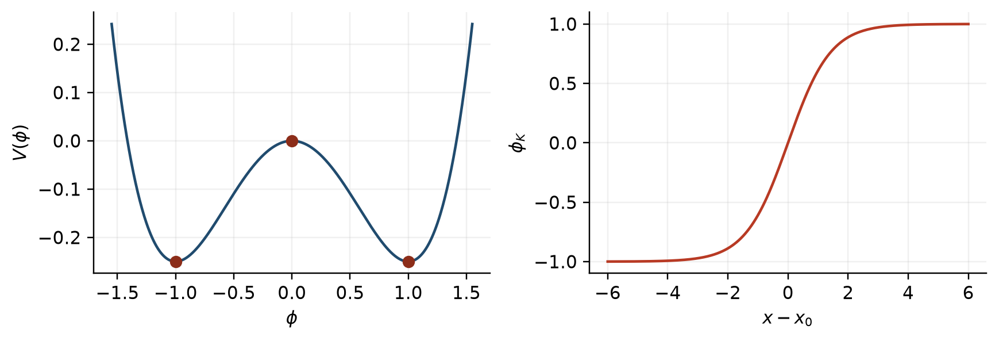
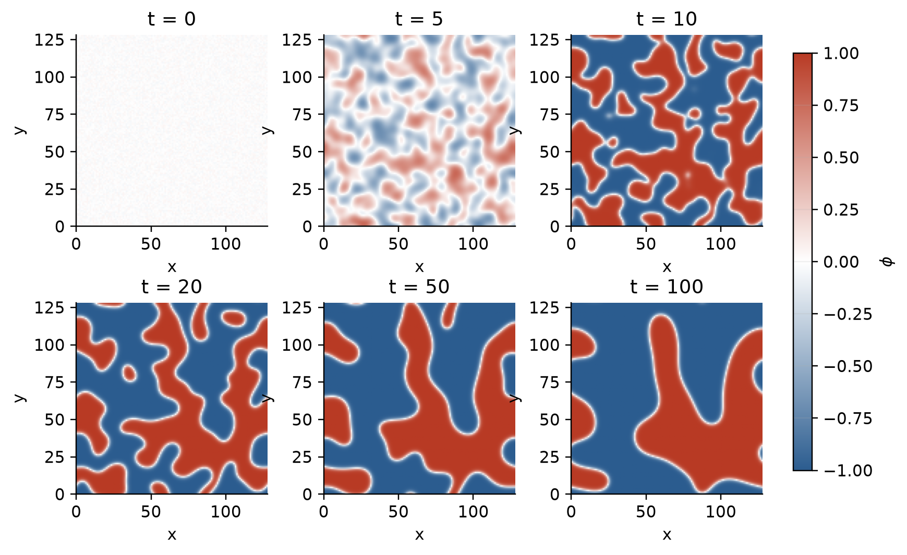
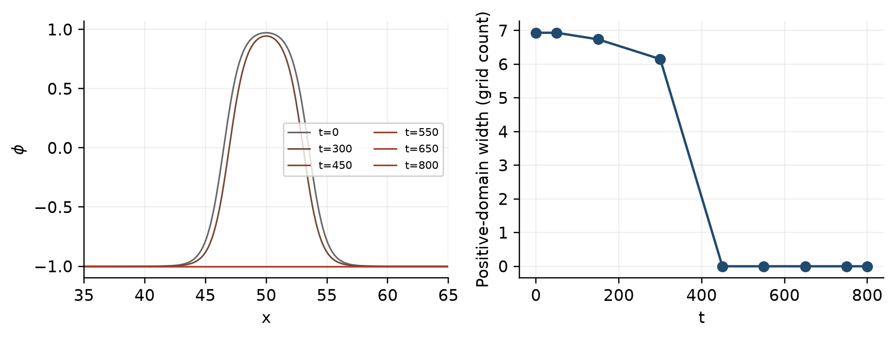
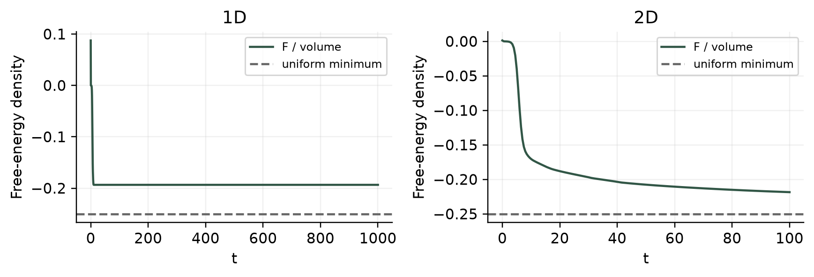
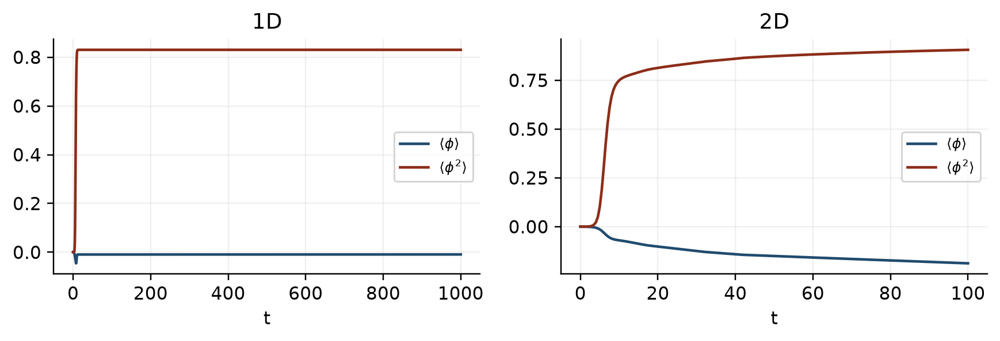
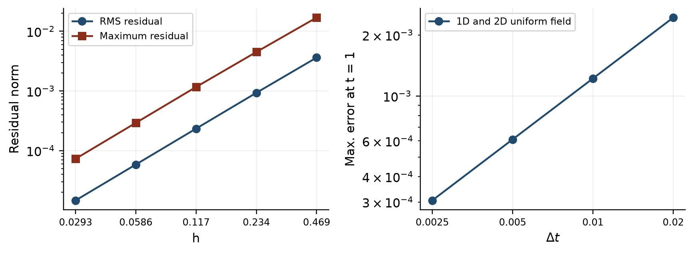
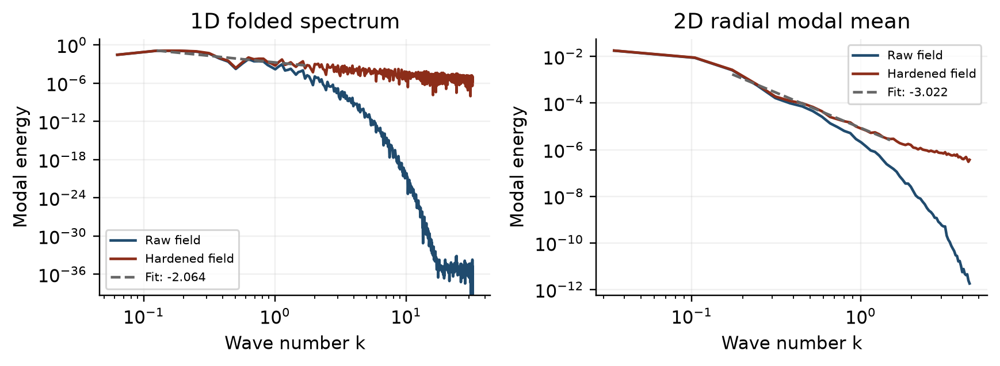

# Project20: Simulating the 1D and 2D TDGL Equation

Chandranil Das (261340004) and Devkinandan Sharma (261340005)

Kotak School of Sustainability

M.Tech in AI for Sustainability

IDC606 | 14 November 2026

## Simulating the 1D and 2D Time-Dependent Ginzburg-Landau Equation

Abstract

We implement and verify the real, nonconserved Model-A time-dependent Ginzburg-Landau (TDGL) equation in one and two dimensions. Periodic finite differences and forward Euler time stepping reproduce ordering from small random fluctuations and annihilation of an isolated kink-antikink pair. The full 1D random run uses 1024 points and 1,000,000 steps; the 2D run uses a 128 × 128 mesh and 10,000 steps. Validation includes fixed points, interior kink residuals, temporal order, Fourier eigenmodes, consistency of the discrete energy gradient, and full-step energy monitoring. Spatial and temporal orders are approximately 1.989 and 0.999. Independent replay of all three trajectories covers 1,810,000 steps, with no free-energy increase above 10<super>-9</super>. The random runs remain partially ordered at their recorded endpoints. Optional spectra are interpreted as finite-window diagnostics rather than an ensemble scaling result.

I. INTRODUCTION

A quench into an ordered phase creates competing domains of positive and negative local order. Domain walls separate these regions; their subsequent motion removes small structures and reduces interfacial free energy. The TDGL equation is a minimal deterministic description of this relaxation when the order parameter is not conserved.

Project20 investigates this equation through finite-difference computation, analytical benchmarks and reproducible numerical evidence. The emphasis is on the connection between the differential equation, its discrete implementation, and the observed fields. No external dataset is used: all initial fields are generated numerically.

A. Source boundary

Verma et al. [1] provide the 1D Model-A setting, domain walls and the coarsening interpretation. Yadav et al. [2], Secs. II B, III and V, provide the dimensionless TDGL model, 1D/2D finite-difference parameters and the ordered-state stability bound.

B. Scope and contribution

The core deliverable is runnable scientific code: real scalar fields, periodic nearest-neighbor spatial differences, explicit time stepping, and diagnostics derived from the same operator. Three full runs are retained: 1D random ordering, 2D random ordering and a 1D kink-antikink annihilation example.

This is a source-guided implementation and verification study. It does not claim bitwise reproduction of the papers, which use different random realizations and observation schedules. The pair separation is deliberately changed to permit annihilation over a practical simulation time.

We examine ordering morphology, interfacial motion and the evolution of free energy. Analytical solutions and grid-refinement studies connect the observed dynamics to the governing equation.

C. Reading the evidence

Sections II-V derive the model, solver and stability conditions. Sections V-VIII specify and interpret the runs. Sections XI-XII test correctness and energy descent. Section XIII reports optional spectral diagnostics. The final sections state limitations and explain how to reproduce the work.

## II. MODEL AND FREE-ENERGY FORMULATION

A. Real, nonconserved order parameter

Let φ(r,t) denote a real coarse-grained local magnetization. The states φ = +1 and φ = -1 represent the two ordered phases. The dimensionless deterministic Model-A dynamics in [1,2] is

$$ \partial_t\phi=\phi-\phi^3+\nabla^2\phi. \qquad (1) $$

For one dimension, the last term is ∂²φ/∂x²; for two dimensions it is ∂²φ/∂x² + ∂²φ/∂y². All reported coordinates and times are dimensionless. There is no fitted material coefficient or experimentally calibrated time scale.

B. Free energy

$$ F[\phi]=\int_\Omega\left[-\frac{\phi^2}{2}+\frac{\phi^4}{4}+\frac{|\nabla\phi|^2}{2}\right]d\mathbf{r}. \qquad (2) $$

The local potential V(φ) is a symmetric double well. Its quartic term limits growth, while the gradient term penalizes interfaces. The unshifted convention above is retained throughout: a uniform ordered state has F = -|Ω|/4, not zero.

$$ V(\phi)=\frac{(\phi^2-1)^2}{4}-\frac{1}{4}. \qquad (3) $$

Adding |Ω|/4 gives a nonnegative excess energy but does not change the equation. Whenever an excess is used below, that shift is stated explicitly.

C. Functional derivative

Perturb φ by εη. The derivative of the gradient contribution is the integral of ∇φ·∇η. Periodicity cancels the boundary term after integration by parts. Thus

$$ \delta F=\int_\Omega(-\phi+\phi^3-\nabla^2\phi)\eta\,d\mathbf{r}, \qquad (4) $$

$$ \frac{\delta F}{\delta\phi}=-\phi+\phi^3-\nabla^2\phi. \qquad (5) $$

The relaxation law ∂tφ = -δF/δφ gives Eq. (1). Its sign is essential: reversing it would increase the free energy and destabilize the ordered phases.

D. Dissipation and changing mean

$$ \frac{dF}{dt}=-\int_\Omega(\partial_t\phi)^2d\mathbf{r}\leq0. \qquad (6) $$

This identity holds for the continuous-time equation and for the associated continuous-time discrete gradient flow. A finite forward Euler step is not automatically energy decreasing for arbitrary Δt.

$$ \frac{d\langle\phi\rangle}{dt}=\langle\phi\rangle-\langle\phi^3\rangle. \qquad (7) $$

The periodic Laplacian has zero spatial sum, but the reaction term generally does not. Hence the mean is allowed to change. In an inhomogeneous field, ⟨φ³⟩ is not generally ⟨φ⟩³; the homogeneous scalar equation cannot be applied to the random-run mean.

## III. ANALYTICAL BENCHMARKS

A. Uniform stationary states

A spatially uniform stationary field satisfies φ - φ³ = φ(1-φ²) = 0. The fixed points are therefore 0 and ±1. For a small perturbation η around a fixed point a, expansion to first order gives

$$ \partial_t\eta=(1-3a^2)\eta+\nabla^2\eta. \qquad (8) $$

For a Fourier perturbation exp(ik·r), the growth rate is σ(k)=1-3a²-|k|². At a=0, long waves with |k|&lt;1 grow; exactly zero remains stationary in exact arithmetic. At a=±1, σ=-2-|k|² and every Fourier mode decays.

B. Exact homogeneous evolution

For a uniform initial field a₀ ≠ 0, spatial derivatives vanish. Solving a′=a-a³ gives [2, Eq. (28)]

$$ a(t)=\frac{a_0}{\sqrt{a_0^2+(1-a_0^2)e^{-2t}}}. \qquad (9) $$

This formula supplies a nonlinear temporal benchmark with no spatial truncation error. The project uses a₀=0.2, T=1 and four decreasing step sizes. It tests the time integrator in both array dimensions; it is not a convergence test of a spatially evolving 2D morphology.

C. Stationary kink

On the infinite line a stationary wall solves φ″+φ-φ³=0 with opposite limits at ±∞. Multiplication by φ′ and one integration gives (φ′)²/2=(φ²-1)²/4. The resulting profile is

$$ \phi_K(x)=\tanh\left(\frac{x-x_0}{\sqrt{2}}\right). \qquad (10) $$

Its width scale is √2. The exact second derivative is -sech²(z)tanh(z), where z=(x-x₀)/√2, which cancels φK-φK³. Substitution into the discrete operator isolates spatial truncation error.

A single tanh profile does not satisfy periodic boundary conditions on a finite interval. The residual is evaluated only on x∈[0.2L,0.8L], excluding the artificial wraparound. Periodic evolution is instead demonstrated with a paired-wall initial field.

D. Excess wall energy

For an isolated continuum wall, the gradient and excess potential densities are equal. Integrating their sum gives σ=(1/√2)∫sech⁴(z) dz=2√2/3 ≈ 0.942809, with integration limits ±∞. This is an analytical integral, not a fitted simulation result. Two well-separated walls therefore have an approximate initial excess of 1.885618; finite separation and grid effects modify it.

## IV. PERIODIC FINITE-DIFFERENCE METHOD

A. Grid and indexing

The 1D domain is [0,L), sampled at xᵢ=ih with h=L/N. The endpoint L is not duplicated. Indices are interpreted modulo N. In 2D, φᵢⱼ is stored with axis 0 representing x and axis 1 representing y; both axes wrap periodically.

$$ (L_h\phi)_i=\frac{\phi_{i+1}-2\phi_i+\phi_{i-1}}{h^2}. \qquad (11) $$

$$ L_h\phi=L_{h_x}^{(x)}\phi+L_{h_y}^{(y)}\phi. \qquad (12) $$

Each directional operator uses the 1D three-point formula along its own axis, with denominator hₓ² or hᵧ². Their sum is the standard five-point stencil.

NumPy roll operations implement these neighbor lookups, including the links between the first and last grid cells. The stencils have O(h²) spatial truncation error for smooth fields.

B. Forward Euler update

$$ R_h(\phi)=\phi-\phi^3+L_h\phi, \qquad (13) $$

$$ \phi^{n+1}=\phi^n+\Delta t\,R_h(\phi^n). \qquad (14) $$

The entire right-hand side is evaluated from the old field before replacement. This prevents an unintended sequential update. Forward Euler has first-order global temporal error under regularity and stability assumptions.

C. Worked first-step calculation

At i=512 in the archived 1D initial field, the three values are approximately (0.03419932, -0.04444321, -0.02193886). With h=0.09765625, the Laplacian is 10.60601922 and the full RHS is 10.56166380. The first Euler step gives φ₅₁₂¹=-0.03388154451. Values are calculated with the unrounded archive entries.

D. Discrete energy matched to the stencil

With cell volume v=h in 1D and v=hₓhᵧ in 2D, define

$$ F_h=v\sum_i\left[V(\phi_i)+\frac{1}{2}\sum_{\alpha=1}^D\left(\frac{\phi_{i+e_\alpha}-\phi_i}{h_\alpha}\right)^2\right]. \qquad (15) $$

Each forward edge is counted once. Differentiating the two edges adjacent to a node gives the nearest-neighbor negative Laplacian. Thus the energy gradient exactly matches the implemented operator:

$$ \frac{\partial F_h}{\partial\phi_i}=-vR_h(\phi)_i. \qquad (16) $$

Using a centered first derivative squared in the energy would produce a different, wider stencil after differentiation. It could give a smooth-looking energy curve without validating the intended discrete gradient flow.

E. Directional-derivative audit

$$ D_\epsilon F_h=\frac{F_h(\phi+\epsilon q)-F_h(\phi-\epsilon q)}{2\epsilon} \qquad (17) $$

$$ D_\epsilon F_h\approx-v\sum_iR_h(\phi)_i q_i. \qquad (18) $$

Random-direction tests compare these two independently computed quantities. This checks the sign, cell-volume factor, periodic edges, and correspondence between energy and evolution. Results are given in Sec. XII.

For the semi-discrete ODE, dFh/dt=-vΣᵢRh². The explicit update approximates this identity to first order in time and must still be checked at the chosen Δt.

## V. STABILITY, PARAMETERS AND EXECUTION

A. Ordered-state stability calculation

Linearizing the numerical scheme about ±1 yields the amplification factor G=1-Δt(2+κh²), where κh² is the nonnegative magnitude of a discrete Laplacian eigenvalue. On a rectangular periodic mesh,

$$ \kappa_h^2=4\sum_{\alpha=1}^D\frac{\sin^2(k_\alpha h_\alpha/2)}{h_\alpha^2}. \qquad (19) $$

Forward Euler requires |G|≤1. Since κh²≤4Σαhα⁻², a sufficient worst-mode bound about these ordered states is

$$ \Delta t\leq\frac{2}{2+4\sum_\alpha h_\alpha^{-2}}. \qquad (20) $$

$$ \Delta t\leq\frac{h^2}{h^2+2D}\quad\mathrm{(equal\ spacing)}. \qquad (21) $$

This is the TDGL criterion in [2, Eq. (35)]. It is a local linear stability condition, not a proof of global nonlinear stability or unconditional energy descent.

For 1D, h²=0.009536743164 and Δtmax=0.004745742120. The selected Δt=0.001 uses 21.07152% of this bound. For 2D, h=1 gives Δtmax=0.2; Δt=0.01 uses 5%.

B. A deliberate failure check

At 1.5 times the 1D bound, Δt=0.007118613180, the validation experiment crosses its numerical blow-up threshold at step 12. This confirms that the stability guard addresses an observable failure mode. It does not locate a universal nonlinear threshold.

C. Full simulation configurations

| Quantity | 1D random / pair | 2D random |
| --- | --- | --- |
| L | 100 | 128 × 128 |
| Grid | 1024 | 128 × 128 |
| Spacing | 0.09765625 | 1 |
| Δt | 0.001 | 0.01 |
| Final time | 1000 / 800 | 100 |
| Steps | 1,000,000 / 800,000 | 10,000 |
| Random seed | 42 / not random | 42 |
| Random range | [-0.05,0.05] | [-0.05,0.05] |

The random runs use NumPy default_rng(42) and independent uniform samples. The finite sample means are not explicitly subtracted: they are -0.0002134007902 in 1D and -0.0001050987139 in 2D.

The grid sizes, box lengths and time steps follow the TDGL entries of [2, Table I]. The chosen observation endpoints and random realizations belong to this project.

D. Execution and data retention

At each step the solver computes the periodic Laplacian, adds the local reaction, and advances the field. Diagnostics and selected snapshots are saved separately. The raw archives contain 504 snapshots for random 1D, 101 for 2D, and nine for the pair experiment.

The standalone experiment drivers execute the full runs. A separate independent replay advances the stored initial fields without importing the project solvers; it checks every time-step energy and compares all saved snapshots. The notebook includes shorter demonstrations for interactive exploration.

## VI. ONE-DIMENSIONAL RANDOM ORDERING

A. Observed evolution

Initially φ lies close to zero. Diffusion rapidly suppresses the finest grid oscillations, while the unstable long-wave reaction-diffusion modes grow. The cubic term saturates the growing amplitudes near ±1. The resulting profile contains ordered intervals separated by narrow walls.

The space-time plot shows wall motion and persistence of domains. Six periodic sign changes remain at t=1000, giving three positive/negative pairs on the ring. Counting includes the link between the final and first grid points.

A simple descriptive spacing is L/6 = 16.6667. This is a wall-count statistic at one time, not a fitted correlation length or a domain-growth law.

B. Quantitative endpoint

| Diagnostic | Initial | Final |
| --- | --- | --- |
| Fh | 8.747047829 | -19.344051079 |
| Fh / L | 0.087470478 | -0.193440511 |
| ⟨φ⟩ | -0.000213401 | -0.009087783 |
| ⟨φ²⟩ | 0.000848455 | 0.830338707 |

The total free-energy drop is 28.091098908. The remaining excess above the uniform minimum is Fh+25=5.655948921. Dividing this by six walls gives about 0.942658 per wall, close to the isolated continuum-wall excess 0.942809. This is a consistency calculation, not an independent measurement of wall tension.

The final state has not become uniform. Reporting complete ordering or a final zero-mode-only field would contradict the saved profile.

![FIG. 2. Actual 1D random-run profiles and space-time evolution. Color is φ on a fixed [-1,1] scale; times come from the stored snapshot array.](figures/02_1d_evolution.png)

## VII. TWO-DIMENSIONAL RANDOM ORDERING

A. Morphology

Small random fluctuations develop into connected regions with φ near +1 and -1. Between t=10 and t=100 the interfaces become smoother and small regions are removed. These images support qualitative coarsening over the simulated interval.

Images plot the transpose of the stored array with the lower origin, so x is horizontal and y vertical. The same color scale is used at every time; the weak t=0 contrast reflects the actual ±0.05 initial amplitude.

The 2D final field is not uniformly ordered. No quantitative growth exponent is extracted: a single finite run without correlation-length analysis or an ensemble cannot establish an asymptotic growth law.

B. Endpoint diagnostics

| Diagnostic | Initial | At t=100 |
| --- | --- | --- |
| Fh | 20.687163455 | -3579.607240902 |
| Fh / 16384 | 0.001262644 | -0.218481887 |
| ⟨φ⟩ | -0.000105099 | -0.187712368 |
| ⟨φ²⟩ | 0.000830890 | 0.906062496 |

The energy drop is 3600.294404357. The uniform minimum is -4096, leaving excess 516.392759098. The nonzero excess and visible walls agree that the trajectory remains away from a uniform minimum.

With h=1, the √2 profile-width scale spans only 1.414 grid spacings. This resolution follows [2], but interface-sensitive quantities need mesh-refinement checks before precise continuum interpretation.

## VIII. KINK-ANTIKINK ANNIHILATION

A. Initial field and purpose

A controlled pair isolates the removal of one small positive domain inside a negative background. The initial profile is

$$ \phi(x,0)=\tanh\frac{x-x_1}{\sqrt{2}}-\tanh\frac{x-x_2}{\sqrt{2}}-1, \qquad (22) $$

with x₁=46.5, x₂=53.5, R₀=x₂-x₁=7 and L=100. Both ends are effectively -1 at floating-point precision, allowing a periodic paired-wall evolution. This is an approximate finite-separation wall superposition, not an exact stationary solution.

The separation is a project choice. The experiment is not an exact reproduction of a reference-paper pair with separation 10 or a trajectory extending to time 30,000.

B. What is measured

Positive-domain width in Fig. 4 is h times the number of positive grid values. It is a grid-count diagnostic, so it is quantized by h and becomes zero after the central field crosses zero. The saved times bracket the process but do not resolve an exact annihilation time.

C. Observed outcome

At first the two walls remain separated. Subsequently the positive interval contracts and disappears. At t=800 the field is uniform to numerical accuracy at φ≈-1; the final mean is -0.9999999999999885.

| Quantity | Value |
| --- | --- |
| Initial Fh | -23.115251403 |
| Final Fh | -25.000000000 |
| Initial excess Fh + 25 | 1.884748597 |
| Final periodic sign changes | 0 |

The initial excess is close to twice the continuum isolated-wall value, as expected for a separated pair. Its small discrepancy is compatible with finite separation and discretization; it is not used to calibrate the model.

Energy decreases toward the correct background value. No kinetic law for separation versus time is fitted here: the nine stored snapshots are suitable for visualization but insufficient for a precise interaction-rate measurement.

## IX. GLOBAL DIAGNOSTICS AND ENERGY ACCOUNTING

A. Definitions

$$ \langle\phi\rangle=\frac{1}{N_{tot}}\sum_i\phi_i,\quad\langle\phi^2\rangle=\frac{1}{N_{tot}}\sum_i\phi_i^2. \qquad (23) $$

The squared moment measures the development of local order: values near one indicate that most cells lie near the ordered phases. It does not distinguish a uniform phase from a mixture of ±1 domains. The mean detects imbalance between those phases but is not conserved.

The energy combines bulk and interface contributions. Division by L in 1D or L² in 2D permits comparison with the common minimum density -1/4. The random-run energy curves approach but do not reach that value.

B. Interpreting the calculations

For 1D, Fh/L=-19.344051079/100=-0.193440511. For 2D, Fh/L²=-3579.607240902/16384≈-0.218481887. Comparing total Fh values directly across dimensions would hide the difference in domain volume.

A rise of ⟨φ²⟩ and a fall of Fh are complementary observations. The first captures local saturation; the second also accounts for walls. The negative final mean in 2D is allowed by Model A and by the chosen random realization.

The plots use saved diagnostics. Full-step monotonicity is verified separately by independent replay; a smooth sampled curve alone cannot exclude an energy increase between saved samples.

## X. DEVELOPMENT OF LOCAL ORDER

A. Separation of mean and local ordering

The early rise of the squared moment accompanies growth away from the disordered state. Later, it remains below one because interfaces contain values between the two ordered phases. A nearly zero mean in the 1D run coexists with strong local order; it does not imply that the entire field remains near zero.

In 2D the mean drifts appreciably negative while both signs remain present. This reflects an evolving imbalance, rather than numerical violation of a conserved quantity. Periodic boundaries conserve neither the Model-A mean nor its squared moment.

B. A useful balance equation

Multiplying the PDE by φ and integrating gives a separate identity for the squared amplitude:

$$ \frac{1}{2}\frac{d\langle\phi^2\rangle}{dt}=\langle\phi^2\rangle-\langle\phi^4\rangle-\langle|\nabla\phi|^2\rangle. \qquad (24) $$

The linear reaction supplies amplitude, the cubic reaction limits it, and diffusion damps gradients. This quadratic-amplitude balance is distinct from the free-energy dissipation identity.

C. Data and sampling

The 1D archive stores 2001 diagnostic times through t=1000; 2D stores 201 times through t=100. These are reporting intervals, not integrator time steps. The integrator still advances at 0.001 and 0.01, respectively.

The final squared moments are 0.830338707 in 1D and 0.906062496 in 2D. These values are averages over the entire grid, including interfaces. They should not be interpreted as fitted phase fractions.

D. Reproducibility of statistics

Each diagnostic is recomputable from the stored snapshots at common times. Raw archives retain fields rather than only figures, so wall counts, energy conventions and means can be independently examined. The notebook presents full simulation fields and shorter demonstrations. Interactive runs allow exploration of initial conditions and numerical parameters; the grid, time step and observation window are specified for each configuration.

All numerical conclusions in this report refer to the single seed and configurations in Sec. V. Differences across random realizations are not quantified. No confidence interval is attached to a single trajectory mean.

## XI. CONVERGENCE AND OPERATOR VERIFICATION

A. Spatial residual of the kink

For L=60 and x₀=30, apply the periodic stencil to the sampled isolated tanh but evaluate only x∈[12,48]. Let r=φK-φK³+LhφK. The reported L2 diagnostic is the root mean square of r on that interior mask; L∞ is the maximum absolute residual.

| N | h | RMS residual |
| --- | --- | --- |
| 128 | 0.468750 | 3.622753 × 10⁻³ |
| 256 | 0.234375 | 9.311354 × 10⁻⁴ |
| 512 | 0.117188 | 2.338518 × 10⁻⁴ |
| 1024 | 0.058594 | 5.850650 × 10⁻⁵ |
| 2048 | 0.029297 | 1.463828 × 10⁻⁵ |

A least-squares fit of log(error) against log(h) gives p=1.989471 for RMS and 1.966403 for maximum residual, consistent with the second-order stencil. This is an interior operator test, not a periodic single-wall dynamics test.

B. Time convergence

The homogeneous exact solution in Eq. (9), with a₀=0.2, has a(1)≈0.485182752. Its exact value is evaluated directly in the test. Errors for Δt=0.02, 0.01, 0.005, 0.0025 are 0.002435093, 0.001219622, 0.000610321 and 0.000305287, respectively.

The fitted order is 0.9986015 in both 1D and 2D because the uniform field suppresses all spatial terms. This confirms first-order Euler behavior but cannot establish the error of the coarse-grid 2D interfaces.

C. Discrete Fourier mode

A periodic mode cos(kₓx+kᵧy) must be an eigenvector of the 2D stencil. The tested discrete eigenvalue is -6.780025273, compared with continuum -6.853891945. The maximum residual against the discrete value is 3.8192 × 10⁻¹³.

The continuum/discrete difference is expected truncation error; comparing the code with the continuum eigenvalue at finite h would conflate operator correctness and grid resolution.

## XII. ENERGY-GRADIENT AND FIXED-POINT VALIDATION

A. Fixed points and perturbations

Uniform +1 and -1 fields give exactly zero residual and no step change in the fixed-point tests. A uniform perturbation ε=0.01 about zero grows to 0.01648168145 at t=0.5. The linear prediction εexp(0.5)=0.01648721271 is close, with the small difference arising from cubic saturation and time discretization.

The exact zero field is stationary; instability means perturbations grow, not that an exactly represented zero spontaneously moves. Separate 2D fixed-point assertions and periodic Fourier checks exercise the two-dimensional implementation.

B. Energy-gradient correspondence

Centered directional differences of Fh are compared against -vΣRhq. The source validation records relative mismatches 1.8080 × 10⁻¹⁰ in 1D and 1.0953 × 10⁻⁸ in 2D. These small finite-difference mismatches support consistency of the discrete energy and RHS.

The independent implementation checker uses separate cases and tolerances; its numbers need not equal the source validation above. Agreement is assessed against its own assertions, rather than by combining different benchmark values.

C. Unit tests

The scientific implementation passes all 13 Python tests. These tests cover the periodic stencil, equilibria, energy behavior and related implementation contracts. They complement, rather than replace, the longer physical trajectories and analytical checks.

D. Independent full replay

A second implementation advances each archived initial field using independent NumPy formulas without importing the project solver or diagnostics. It computes energy after every step, checks finiteness, and compares every saved field against the archive.

| Run | Steps | Max. field difference |
| --- | --- | --- |
| 1D random | 1,000,000 | 2.491 × 10⁻¹² |
| 2D random | 10,000 | 2.665 × 10⁻¹⁵ |
| 1D pair | 800,000 | 1.429 × 10⁻¹³ |

Across 1,810,000 steps, there are zero energy increases above 10⁻⁹. The maximum positive stepwise increase in the pair run is 3.553 × 10⁻¹⁵, consistent with floating-point roundoff at the final uniform state. Both random runs show negative maximum stepwise changes.

Replaying the same discrete equations verifies implementation and saved-data consistency. It does not prove continuum accuracy or independence from mesh and initial seed.

E. Numerical records

The submission retains machine-readable validation JSON, convergence CSV, independent replay summaries and energy traces. Each figure in this report is generated from the retained archives or those validation values.

## XIII. OPTIONAL FOURIER DIAGNOSTICS

A. Definition and normalization

$$ \widehat\phi_k=\mathrm{FFT}(\phi)_k/N_{tot},\quad E_k=\frac{1}{2}|\widehat\phi_k|^2. \qquad (25) $$

Parseval then gives ΣkEk=⟨φ²⟩/2. This quadratic modal energy is not the Ginzburg-Landau free energy Fh. In 1D the reported spectrum folds the positive and negative wave numbers. In 2D a radial-bin modal mean is distinguished from the shell sum, which contains a geometric mode-count factor.

Following the sharp-interface diagnostic used in [2, Sec. V B], a hardened field sign(φ) is also analyzed. Hardening changes the field and removes the smooth wall profile. Raw and hardened curves therefore answer different questions.

B. Finite-window fits

The hardened spectra are fit by log-linear regression on fixed positive-k windows. The 1D fit uses 27 points with 0.1≤k≤1.8; the 2D modal-mean fit uses 20 radial bins with 0.15≤k≤1.5.

| Diagnostic | Exponent | R² |
| --- | --- | --- |
| 1D hardened | -2.0638 ± 0.2907 | 0.6685 |
| 2D hardened modal | -3.0220 ± 0.0657 | 0.9916 |

The quoted ± values are regression standard errors only. They exclude seed variation, fitting-window selection, radial-bin dependence, interface-resolution error and correlations between residuals.

The slopes are compatible descriptively with the sharp-interface k⁻² and k⁻³ modal trends for D=1 and D=2. The 1D fit is visibly noisier and has limited goodness of fit. These are optional single-realization diagnostics, not a demonstration of universal asymptotic scaling.

C. Scope of the spectral result

No nonlinear transfer function or intermode flux is reported here. A spectrum alone does not measure energy transfers. The project's main verified claims rest on fields, equilibria, stencil consistency, convergence and energy descent.

## XIV. DISCUSSION, CONCLUSIONS AND REPRODUCIBILITY

A. What the project establishes

The implemented equation is the real, nonconserved Model-A TDGL model specified by the source papers. Its periodic finite differences and forward Euler integrator produce growth of ordered regions, saturation near ±1, and removal of a paired domain. Energy and operator diagnostics are derived consistently from the same nearest-neighbor stencil.

The spatial residual converges at approximately second order and the isolated temporal benchmark at first order. Fixed points and Fourier modes behave as expected. Independent replay reproduces the full saved trajectories to small floating-point differences and confirms numerical energy descent at every simulated step within the stated tolerance.

B. Limits of the evidence

The random runs do not reach uniform final states within the chosen time windows. A single seed does not establish ensemble behavior. The 2D grid follows the paper but resolves the wall width coarsely; precise interfacial measurements need finer meshes and convergence studies. The homogeneous time test isolates the integrator, not full space-time accuracy.

The paired-wall example changes the initial separation to shorten the observed process. Its nine snapshots do not determine an accurate annihilation time or interaction law. Optional spectral regressions carry only regression uncertainty and should not be presented as universal scaling verification.

C. Reproducing the simulations

The project includes the report, five-slide presentation and scientific code. The notebook executes short demonstrations and displays full archived results. The standalone drivers reproduce the long runs; no web service or external dataset is needed.

D. Code map and execution

| Path under codes/ | Purpose |
| --- | --- |
| src/tdgl_core.py | Periodic stencils, RHS, Euler and matched energy |
| src/tdgl_1d.py; tdgl_2d.py | Simulation loops and diagnostics |
| experiments/run_all.py | Full experiments and validation |
| tests/test_tdgl.py | 13 automated tests |
| audit/replay_runs.py | Independent complete replay |
| P20_Simulations.ipynb | Executed notebook walkthrough |
| results/raw/ | Computed fields and spectra |

Run from codes/: create a Python environment, install requirements.txt, then run python -m pytest -q. For notebook use install requirements-notebook.txt and open P20_Simulations.ipynb. Run python -m experiments.run_all for the full pipeline. Full reruns overwrite generated results; copy the submission first if retaining the supplied outputs is desired.

Saved fields, diagnostic series and convergence measurements accompany the code. The interactive application allows exploration of initial conditions and numerical parameters; observation windows are stated for each run.

REFERENCES

[1] M. K. Verma, R. Agrawal, P. K. Yadav, and S. Puri, “Nonlinear energy dissipation and transfers in coarsening systems,” Physical Review E <b>107</b>, 034207 (2023). DOI: 10.1103/PhysRevE.107.034207.

[2] P. K. Yadav, M. K. Verma, and S. Puri, “Spectral energy transfers in domain growth problems,” Physical Review E <b>110</b>, 044130 (2024). DOI: 10.1103/PhysRevE.110.044130.
