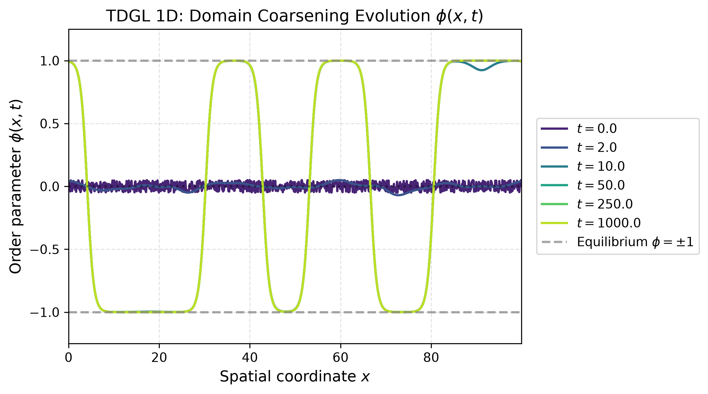
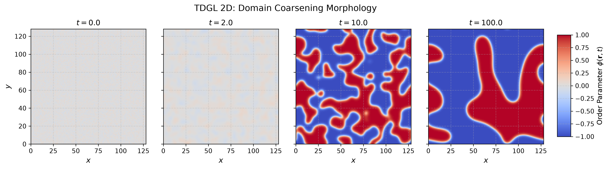
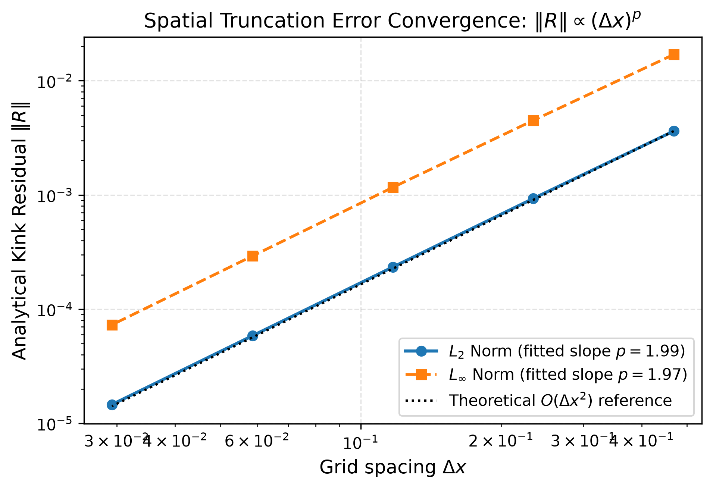
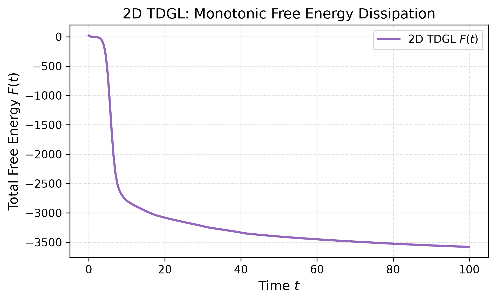

# P20 | TDGL in 1D and 2D

## Technical report • executed simulations and independent verification

## Scope and sources

The allocation specifies numerical simulation of the 1D and 2D TDGL equation. The two supplied papers [1,2] define the real scalar, nonconserved Model-A problem. All fields here originate from specified initial conditions. No external dataset, superconducting order parameter or electromagnetic coupling is used.

## Model and variational formulation

∂φ/∂t = φ − φ³ + ∇²φ = −δF/δφ

F[φ] = ∫ [−φ²/2 + φ⁴/4 + |∇φ|²/2] dr

With periodic boundaries, integration by parts gives δF/δφ = −φ + φ³ − ∇²φ and dF/dt = −∫(∂φ/∂t)² dr ≤ 0. The uniform fixed points are 0 and ±1. A homogeneous perturbation grows near 0, whereas ±1 are linearly stable. The infinite-line kink is φ(x) = tanh[(x−x₀)/√2]. [1, Eq. 1; 2, Eqs. 2, 22–23]

## Discretization and parameters

Forward Euler advances φⁿ⁺¹ = φⁿ + Δt(φⁿ − (φⁿ)³ + Δₕφⁿ). The Laplacian uses nearest-neighbour central differences: the three-point stencil in 1D and five-point stencil in 2D. Circular indexing enforces periodicity. [2, Sec. III]

| Run | Box / grid | Δx | Δt | Final t |
| --- | --- | --- | --- | --- |
| 1D random | 100 / 1024 | 0.09765625 | 0.001 | 1000 |
| 2D random | 128 / 128×128 | 1 | 0.01 | 100 |
| 1D wall pair | 100 / 1024 | 0.09765625 | 0.001 | 800 |

The random runs use NumPy default_rng seed 42 and independent uniform values in [−0.05,0.05]. Their ensemble mean is zero; individual sample means are not forced to zero. Table I of [2] supplies both main grid and time-step settings.

The discrete energy uses forward edge differences, ½Σₐ[(φᵢ₊ₑₐ−φᵢ)/hₐ]², counted once per edge. Its negative gradient divided by cell volume equals the implemented RHS. This consistency matters when checking dissipation.

## Executed dynamics

## 1D: domains persist through t = 1000

The random run ends with 6 periodic sign changes and mean φ = -0.009088. The late curves nearly overlap: this realization retains long-lived walls. Complete uniform ordering is not observed during this run.

## 2D: small domains disappear and larger regions remain

The 128×128 run develops positive and negative regions and coarsens through t = 100. Its final mean is -0.187712 and ⟨φ²⟩ = 0.906062. These are morphology observations, not a measured growth exponent.

A separate periodic kink–antikink case starts at x₁=46.5 and x₂=53.5 (R₀=7). It reaches φ≈−1 by t=800. This shortened-separation demonstration is not a reproduction of the R₀=10, t=30000 experiment in [1, Sec. V A]. GIFs and space–time plots accompany the saved numerical fields.

## Validation and numerical evidence

| Check | Result / interpretation |
| --- | --- |
| Uniform states | 0 and ±1 remain fixed; a small homogeneous perturbation of 0 grows. |
| Kink residual | Interior RMS residual order p = 1.9895; max-norm order 1.9664. |
| Time refinement | Exact homogeneous nonlinear solution: measured Euler order 0.99860 in both 1D and 2D. |
| Periodic stencil | Independent Fourier eigenmode errors below 4×10⁻¹⁴, including unequal 2D spacing. |
| Energy consistency | Independent finite-difference directional derivatives agree with −cell volume × RHS; relative errors below 10⁻⁸. |

A single tanh is not periodic. Its residual convergence is evaluated only in the fixed interior window x∈[12,48] of a length-60 interval. This demonstrates local second-order truncation accuracy, not a globally periodic stationary kink or full 2D solution convergence.

## Stability and energy

Linearization about ±1 gives Δt ≤ h²/(h²+2D) [2, Eq. 35]. The chosen steps use 21.07% (1D) and 5.00% (2D) of this bound. It is not unconditional nonlinear stability. A deliberate 1D overstep reaches the code’s blow-up threshold at step 12.

| Run | F(0) | F(final) | Every-step check |
| --- | --- | --- | --- |
| 1D random | 8.747048 | -19.344051 | 0 violations >10⁻⁹ |
| 2D random | 20.687163 | -3579.607241 | 0 violations >10⁻⁹ |
| 1D pair | -23.115251 | -25.000000 | 0 violations >10⁻⁹ |

An independent implementation replayed 1,810,000 integration steps across these three experiments. Every step passed the energy check; all saved fields agreed within 2.5×10⁻¹². Roundoff-sized positive differences are allowed near the uniform equilibrium.

## Interpretation, limits and reproduction

## Optional spectra

The FFT convention is φ̂ = FFT(φ)/number of grid points, so Σₖ|φ̂|²/2 = ⟨φ²⟩/2. This quadratic spectral quantity differs from the decreasing GL free energy F. The 1D output folds ±k; 2D outputs distinguish mean modal energy in a shell from the shell sum. Parseval checks cover even/odd 1D grids and 2D mode accounting.

The papers discuss Porod tails k⁻² in 1D and k⁻³ for angle-averaged modal energy in 2D. A 2D shell sum instead gains a geometric factor. Hardening φ to sign(φ), as in [2, Sec. V B], sharpens interfaces for a separate diagnostic. Fits are descriptive checks on one realization and selected intervals; regression standard errors do not capture seed, discretization or fit-window uncertainty. The core solver validation does not rely on these fits.

## Limits of this project

The reference 2D mesh h=1 is coarse relative to the tanh scale √2. Matching the reference setup does not establish continuum accuracy at this resolution. Finite periodic boxes and finite run times constrain coarsening. No ensemble growth law, universal exponent or exact reproduction of the papers’ random realizations is claimed. The wall-pair separation was deliberately changed for a practical annihilation demonstration.

## Reproduction and provenance

Run commands from the IDC_P20 project root after installing requirements in a virtual environment. The package includes source code, the original three source files, saved arrays/CSV tables, figures, animations and independent audit scripts.

python -m pytest -q

python experiments/run_all.py

python audit/replay_runs.py

python audit/temporal_convergence.py

python audit/check_implementation.py audit/implementation_checks.json

The main output files are results/raw/tdgl_1d_random.npz, tdgl_2d_random.npz and tdgl_1d_kink_antikink.npz. Validation tables are in results/validation/. Independent checks and execution evidence are in audit/. The README lists presentation and figure regeneration commands.

## Audit corrections

Independent review identified and corrected inconsistent discrete-energy gradients, Fourier mode accounting, a distorted time axis for uneven snapshots, and animation frames sharing a mutable rendering buffer. Draft report claims were checked against numerical artifacts. A passing test suite alone was not treated as evidence that figures or scientific claims were correct.

## References

[1] M. K. Verma, R. Agrawal, P. K. Yadav and S. Puri, “Nonlinear energy dissipation and transfers in coarsening systems,” Physical Review E 107, 034207 (2023). DOI: 10.1103/PhysRevE.107.034207. Supplied PDF.

[2] P. K. Yadav, M. K. Verma and S. Puri, “Spectral energy transfers in domain growth problems,” Physical Review E 110, 044130 (2024). DOI: 10.1103/PhysRevE.110.044130. Supplied PDF.
